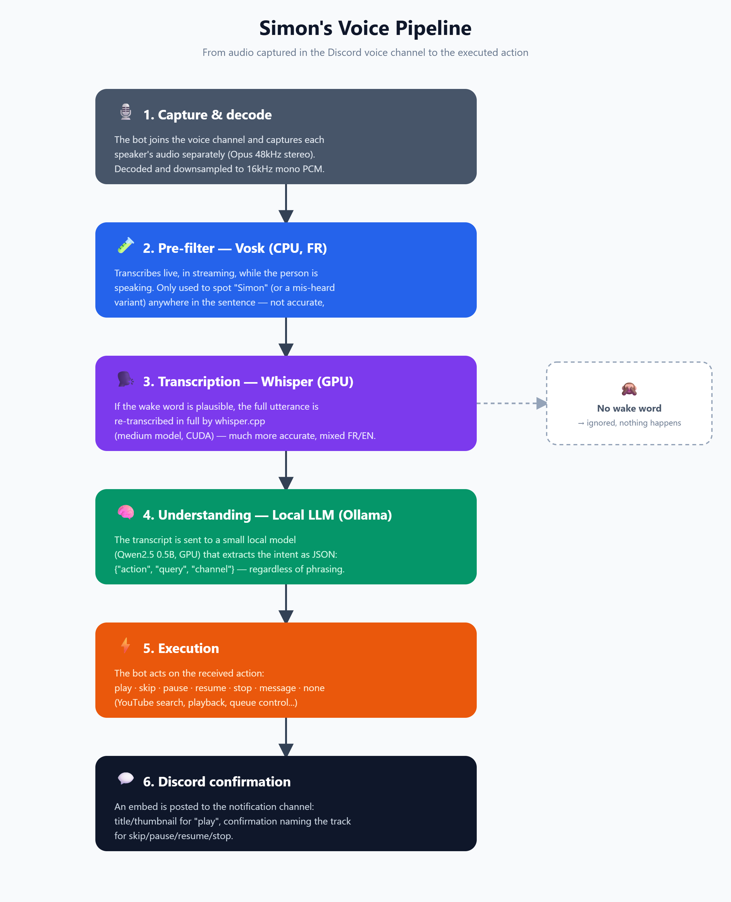

# simon

> **Why "Simon"?** The name's origin means *"the one who listens."* Fitting, for a bot whose only job is to listen.

A Discord bot that listens to a voice channel, and when it hears its wake word, transcribes the request and acts on it — playing/queuing music, sending messages, or controlling playback.

⚠️ The wake word itself is French ("Simon"), but commands can be phrased however you'd naturally say them, in French or English — see [How it works](#how-it-works).

## Table of contents

- [Prerequisites](#prerequisites)
- [Setup](#setup)
- [Docker](#docker)
- [Environment variables](#environment-variables)
- [How it works](#how-it-works)
- [Voice commands](#voice-commands)
- [Local LLM (Ollama)](#local-llm-ollama)
- [Notifications](#notifications)
- [Q&A](#qa)

## Prerequisites

- Node.js 22+
- `ffmpeg` on PATH (used to transcode streamed audio)
- Linux or WSL (the native Vosk/Whisper bindings in `vosk/native`/`whisper/native` are built for `linux-x64` and `win-x64`; Windows native compilation of some dependencies is not supported — see `vosk/models/README.md` if you need another platform)
- Vosk model files (see `vosk/models/README.md`)
- A Whisper model file (see `whisper/models/README.md`)
- A `whisper-cli` binary for your machine (see `whisper/native/README.md`) — unlike Vosk's, this one isn't vendored and you build it yourself; skip it entirely if using Docker
- [Ollama](https://ollama.com) running a small instruction-tuned model, reachable from wherever the bot runs (see [Local LLM](#local-llm-ollama) below)
- A CUDA-capable GPU is strongly recommended for Whisper (a few seconds per command on CPU vs ~1-2s on GPU) — see `whisper/README.md` for the CPU-only fallback

## Setup

Assumes the Prerequisites above are already done — models downloaded, `whisper-cli` built for your machine, Ollama running with a model pulled.

1. `npm install`
2. Copy `.env.blank` to `.env` and fill in the values (see below)
3. `npm run build` then `npm start`, or `npm run dev` for pretty/verbose logs

Or skip straight to [Docker](#docker) below — it also builds whisper.cpp with CUDA and runs Ollama for you, so there's nothing to install on the host at all beyond Docker itself.

## Docker

Everything — the bot, Whisper (built with CUDA inside the image), and Ollama (with the model auto-pulled on first run) — runs via `docker compose up`, no manual build or host-side Ollama setup required.

Requirements: Docker Desktop with the WSL2 backend and GPU support enabled (Settings → Resources → WSL Integration, and the "Enable GPU support" option — on by default once NVIDIA's WSL driver is detected, which you already have if `nvidia-smi` works in WSL).

1. Get the model files (not baked into the image — they're mounted in, so rebuilding the image doesn't mean re-downloading them): `vosk/models/README.md` and `whisper/models/README.md`.
2. Copy `.env.blank` to `.env` and fill in the values, same as the manual setup. `OLLAMA_BASE_URL`/`OLLAMA_MODEL` are read by `docker-compose.yml` itself (to point the bot at the `ollama` service and to pull the right model) — no separate Ollama install needed.
3. `docker compose up --build`

First run: the image build compiles `whisper.cpp` with CUDA from source (several minutes), and the `ollama` service pulls the model into a persistent volume and warms it into VRAM before reporting healthy (size depends on the model — a few minutes). Both are cached afterward: `docker compose up` on a later run just starts the containers, and only re-triggers the slow parts if you change `src/`, `package.json`, the Dockerfile, or `OLLAMA_MODEL`.

Targets an Ampere GPU (`CMAKE_CUDA_ARCHITECTURES=86`, e.g. RTX 30xx) by default — override with `docker compose build --build-arg CUDA_ARCH=89` for RTX 40xx, `75` for RTX 20xx/GTX 16xx, etc.

Prefer to keep using your own host Ollama instead (e.g. you've already got other models pulled there)? Delete the `ollama` service from `docker-compose.yml`, set `OLLAMA_BASE_URL: http://host.docker.internal:11434` on the `bot` service instead, and make sure Ollama is listening on more than `127.0.0.1` (see [Local LLM](#local-llm-ollama)).

## Environment variables

| Variable | Required | Description |
|---|---|---|
| `DISCORD_BOT_TOKEN` | yes | Bot token |
| `DISCORD_SERVER_ID` | yes | Guild ID the bot joins |
| `DISCORD_SERVER_CHANNEL_ID` | yes | Voice channel ID the bot joins |
| `VOSK_MODEL_PATH` | yes | Path to the French Vosk model directory |
| `SAMPLE_RATE` | no (default `16000`) | Vosk/Whisper sample rate |
| `CHUNK_SIZE` | no (default `4000`) | PCM chunk size (bytes) fed to Vosk |
| `MUSIC_CACHE_ENABLED` | no (default `false`) | Cache downloaded/streamed tracks to disk under `music/`, keyed by video ID |
| `MUSIC_NOTIFICATION_CHANNEL_ID` | no | Text channel ID where music/command embeds are posted. Leave empty to disable |
| `WHISPER_MODEL_PATH` | no (default `./whisper/models/ggml-small.bin`) | Path to the Whisper model file |
| `CUDA_LIB_PATH` | no (default `~/cuda-toolkit/lib64`) | Where to find `libcudart`/`libcublas` for GPU-accelerated Whisper. Irrelevant for a CPU-only build |
| `OLLAMA_MODEL` | no (default `hf.co/Qwen/Qwen2.5-0.5B-Instruct-GGUF:Q8_0`) | Model name as known to your Ollama instance |
| `OLLAMA_BASE_URL` | no | Override for the Ollama API URL. Left empty, the bot resolves WSL2's host gateway IP at runtime (works when Ollama runs on the Windows host) |
| `NODE_ENV` | no | `development` enables pretty console logs |
| `LOG_LEVEL` | no (default `info`) | pino log level |

## How it works



Speech recognition runs in two passes, trading off a cheap/fast model against an accurate/flexible one:

1. **Capture**: the bot joins the voice channel and subscribes to each speaker's audio individually (per-user, so multiple people talking at once are each transcribed, not just the first).
2. **Decode**: Discord's Opus audio is decoded to 48kHz stereo PCM, then downsampled to 16kHz mono (with basic anti-aliasing).
3. **Pre-filter (Vosk)**: a single French Vosk recognizer streams the audio live and produces a transcript when the speaker goes silent. Native calls run on a worker thread pool (via `koffi`) so decoding never blocks Discord's audio playback. This transcript is only used to cheaply decide whether the wake word ("simon", or a near-homophone Vosk commonly mishears it as: "c'est mon", "six mots", "ces mots", "si mon") is plausibly present *anywhere* in the utterance — not to parse the actual command. This keeps the expensive steps below from running on every unrelated thing said in the channel.
4. **Transcription (Whisper)**: if the pre-filter matches, the *entire* utterance's raw audio is re-transcribed by `whisper.cpp` (see `whisper/README.md`) — a single multilingual model, so French commands and English song titles are both handled accurately without needing a second recognizer or any FR/EN disambiguation logic.
5. **Command parsing (local LLM)**: the Whisper transcript is sent to a small instruction-tuned model running locally via Ollama (see [Local LLM](#local-llm-ollama)), which extracts the intended action as JSON — regardless of word order, verb choice, or where in the sentence the wake word falls. "simon mets *X*", "lance *X* simon", "*X* stp simon" all resolve to the same `play` command with the same query.
6. **Execution**: the bot acts on the parsed action — `play`, `skip`, `pause`, `resume`, `stop`, `message`, or `none` if nothing was recognized.

## Voice commands

Say the wake word anywhere in the sentence — before, after, or in the middle of the request. Phrasing is flexible since it's parsed by an LLM, not matched against a fixed keyword list; these are just illustrative:

| Say (examples) | Effect |
|---|---|
| "simon mets *du eminem*", "lance *bohemian rhapsody* simon", "*X* simon stp" | Plays the track if nothing is playing, otherwise queues it |
| "simon tu peux skip", "simon passe à la suivante" | Skips to the next queued track |
| "simon mets en pause" | Pauses playback |
| "simon reprends" | Resumes playback |
| "simon stop", "simon on arrête tout" | Stops playback and clears the queue |
| "simon envoie *message* dans *#channel*" | Sends a text message to that channel |

Music is streamed directly (no full download before playing); with `MUSIC_CACHE_ENABLED=true`, each track is also saved to `music/` so repeat requests skip straight to the cached file.

The actual prompt (with the full set of few-shot examples used to keep the small model reliable) lives in `src/llm/command-prompt.ts` — tune it there if a particular phrasing keeps getting misread.

## Local LLM (Ollama)

This section is for the manual (non-Docker) setup — the Docker setup pulls and runs Ollama for you.

1. Install [Ollama](https://ollama.com) and pull a small instruction-tuned model, e.g.:
   ```bash
   ollama pull hf.co/Qwen/Qwen2.5-0.5B-Instruct-GGUF:Q8_0
   ```
2. If Ollama runs on Windows while the bot runs in WSL2, Ollama needs to listen on more than just `127.0.0.1` for WSL to reach it:
   - Set the `OLLAMA_HOST` environment variable to `0.0.0.0:11434` (persistent user env var on Windows), then restart Ollama.
   - The bot resolves WSL2's NAT gateway IP at runtime (`ip route`) to reach it — no config needed in the common case. Set `OLLAMA_BASE_URL` to override (e.g. if using WSL2 mirrored networking mode, where plain `http://localhost:11434` works instead).
3. Set `OLLAMA_MODEL` in `.env` if you're not using the default.

Bigger models (the repo's own testing also used `qwen2.5:7b`) are more reliable at generalizing to verbs/phrasings not covered by the prompt's examples, at the cost of some latency.

## Notifications

If `MUSIC_NOTIFICATION_CHANNEL_ID` is set, the bot posts an embed to that channel for each music event:

- **`play`**: a "Now Playing" or "Added Track" embed with the track's title/thumbnail/link, requester, and (if queued) the estimated wait time and position in queue.
- **`skip` / `pause` / `resume` / `stop`**: a short confirmation embed naming the action and the affected track, e.g. "⏭️ Skipped [Title by Author](url)".

## Q&A

<details>
<summary>Why a separate LLM to understand the command instead of regex/keywords?</summary>
<br>

Spoken phrasing varies too much to enumerate: word order, verb choice ("mets"/"lance"/"joue"/"balance"...), filler words, and where the wake word falls in the sentence. A regex/keyword matcher would need an ever-growing list of patterns and still break on anything not anticipated, or on Whisper's minor transcription noise. The LLM generalizes from a handful of examples (see `src/llm/command-prompt.ts`) to phrasings it's never explicitly seen, at the cost of ~1-2s of extra latency.
</details>

<details>
<summary>Why is the wake word in French when the bot understands English too?</summary>
<br>

The wake word only needs to be detected cheaply and reliably by Vosk's live streaming pre-filter — keeping it fixed to one language keeps that step small and fast (one Vosk model, one known set of mis-hearings to match against, e.g. "c'est mon", "si mon"). "Simon" was picked because it's the bot's name and a natural word to say in French. Only the *wake word* is fixed — everything said after it is free-form and multilingual, because that part is handled by Whisper (multilingual) and the LLM, not by Vosk. A second wake word in another language would mean running a second Vosk recognizer per utterance — exactly the FR/EN disambiguation problem a single multilingual Whisper model was chosen to avoid (see `whisper/README.md`).
</details>

<details>
<summary>Why does Vosk run on CPU and not GPU?</summary>
<br>

Vosk's (Kaldi's) acoustic model is tiny next to Whisper's, and its decoding is a WFST graph search — sequential and branchy, not the dense matrix math GPUs are built for. It also runs continuously on small streaming chunks (effectively batch size 1), where kernel-launch/data-transfer overhead would outweigh any GPU speedup. On top of that, Vosk here is deliberately a cheap, low-stakes pre-filter (just "is the wake word plausibly in there?") — it's already fast enough on CPU and is never the bottleneck, so putting it on GPU would just add contention with Whisper and Ollama for no real benefit.
</details>

<details>
<summary>How much VRAM does this use in total (Whisper + Ollama)?</summary>
<br>

Measured on this project's own setup (RTX 3070, 8GB): the Ollama model (`Qwen2.5 0.5B Q8_0`) sits at ~616MB, kept loaded indefinitely (`OLLAMA_KEEP_ALIVE=-1`). Whisper isn't a server — `whisper-cli` loads the model, transcribes, and exits for every single command — so the `medium` model only adds its own footprint (~2.3GB, measured by polling `nvidia-smi` during a transcription) transiently, for the ~1-2s a command takes, then releases it. So steady-state usage is just Ollama's ~600MB, with short peaks to ~3GB while a command is actively being processed.
</details>

<details>
<summary>Why does the Docker build recompile whisper.cpp every time instead of using a ready binary?</summary>
<br>

There's no portable binary to use: `whisper-cli` is linked against a specific CUDA toolkit version, GPU architecture, and glibc, so a binary built on one machine generally won't run on another (see `whisper/native/README.md`). Rather than ship something that only works on the exact machine it was built on, the Dockerfile compiles `whisper.cpp` fresh inside the image every time, against the image's own CUDA toolkit — so the result works on any machine that can run that image, as long as `CUDA_ARCH` matches the GPU (see [Docker](#docker)). It's cached after the first build, so this only costs time once.
</details>

<details>
<summary>Would this work with an AMD or Intel GPU instead of NVIDIA?</summary>
<br>

Not as-is. The CUDA acceleration in both the Dockerfile and the manual build path is NVIDIA-specific (`GGML_CUDA`, the CUDA toolkit, `nvidia-container-toolkit` for Docker GPU passthrough). `whisper.cpp` does support other backends (Vulkan, ROCm for AMD, etc.), but none of that is wired up here — you'd need to rebuild `whisper.cpp` with the relevant backend flag instead of `-DGGML_CUDA=ON`, adjust `docker-compose.yml`'s GPU reservation (currently `driver: nvidia`), and Ollama would need the matching backend/driver on its own side too. Without any GPU backend, everything still works on CPU, just slower (see [Prerequisites](#prerequisites)).
</details>
